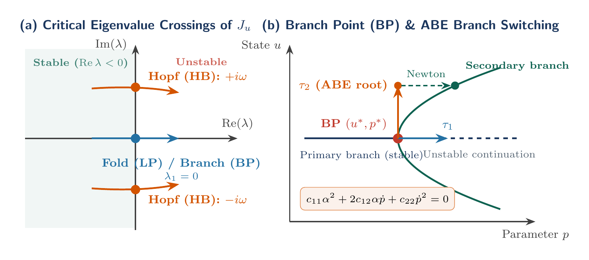
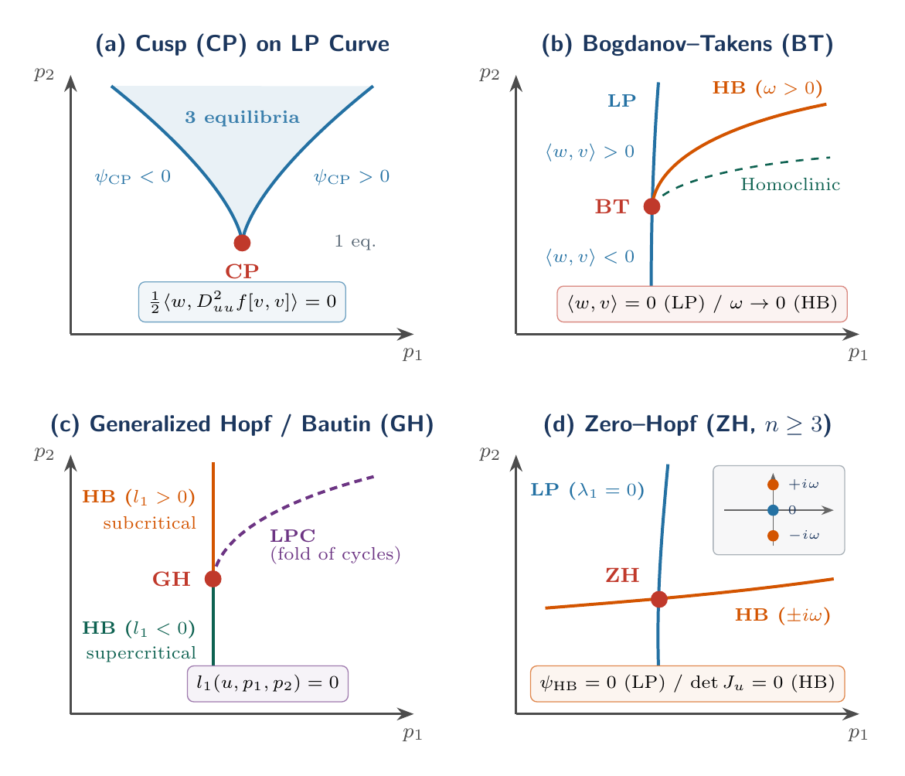

# Bifurcation Theory and Branch Switching

In parameterized dynamical systems and equilibrium problems $F(u, p) = 0$, **bifurcations** mark qualitative structural changes in the number, topology, or stability of equilibrium solutions as parameter $p$ varies.

---

## 1. Classification of Codimension-1 Bifurcations

Let $J_u = \nabla_u F(u, p) \in \mathbb{R}^{n \times n}$ and $J_p = \nabla_p F(u, p) \in \mathbb{R}^n$.

### 1.1 Limit Point / Fold (LP)
A **Limit Point** (also called a saddle-node or turning point) occurs when the equilibrium manifold exhibits a fold with respect to the parameter $p$:

- **Singularity**: $J_u$ has a simple eigenvalue $\lambda_1 = 0$.
- **Transversality**: $J_p \notin \text{Range}(J_u)$, which means $\psi^T J_p \ne 0$, where $\psi$ is the left null vector ($J_u^T \psi = 0$).

#### Test Function
Along the pseudo-arclength curve parameterized by $s$, the parameter velocity $\dot{p} = \frac{dp}{ds}$ changes sign:

$$\psi_{\text{LP}}(\tau) = \dot{p}$$

A fold point is detected when $\psi_{\text{LP}}$ crosses zero between consecutive continuation steps:

$$\psi_{\text{LP}}(\tau_k) \cdot \psi_{\text{LP}}(\tau_{k+1}) < 0$$

#### Moore-Spence Augmented System for Fold Refinement
Because $J_u$ is singular at the fold, refining the point by continuing along $p$ fails. Instead, `bifurx` solves the $(2n+1)$-dimensional **Moore-Spence augmented system**:

$$G(u, p, v) = \begin{pmatrix} F(u, p) \\ J_u(u, p) v \\ l^T v - 1 \end{pmatrix} = \begin{pmatrix} 0 \\ 0 \\ 0 \end{pmatrix}$$

where $v \in \mathbb{R}^n$ is the right null vector ($J_u v = 0$), and $l \in \mathbb{R}^n$ is a fixed normalization vector (chosen as $l = v_0 / \|v_0\|$).

The Jacobian matrix of $G(u, p, v)$ at a simple fold point is:

$$\nabla_{(u, p, v)} G = \begin{pmatrix} J_u & J_p & 0 \\ \nabla_u(J_u v) & \nabla_p(J_u v) & J_u \\ 0 & 0 & l^T \end{pmatrix}$$

This augmented Jacobian is **guaranteed to be non-singular** at an isolated fold point. Applying Newton's method to $G(u, p, v) = 0$ converges quadratically to machine precision without numerical ill-conditioning.

---

### 1.2 Branch Point (BP)
A **Branch Point** (transcritical, supercritical/subcritical pitchfork, or symmetry-breaking bifurcation) occurs where two distinct solution branches intersect transversally:

- **Singularity**: $J_u$ has a simple eigenvalue $\lambda_1 = 0$.
- **Transversality**: $J_p \in \text{Range}(J_u)$, so $\psi^T J_p = 0$.

#### Test Function
A naive determinant $\det(J_u)$ vanishes at both folds (LP) and branch points (BP). To isolate branch points cleanly without firing at regular folds, `bifurx` monitors the determinant of the **bordered continuation Jacobian**:

$$\psi_{\text{BP}}(u, p, \tau) = \det \begin{pmatrix} J_u(u, p) & J_p(u, p) \\ \dot{u}^T & \dot{p} \end{pmatrix}$$

At a regular fold, the bordered matrix remains nonsingular ($\psi_{\text{BP}} \ne 0$). At a simple branch point, $J_p \in \operatorname{Range}(J_u)$, so the extended Jacobian $[J_u \;\; J_p]$ drops rank and $\psi_{\text{BP}}$ crosses zero cleanly: $\psi_{\text{BP}, k} \cdot \psi_{\text{BP}, k+1} < 0$.

---

### 1.3 Hopf Bifurcation (HB)
A **Hopf Bifurcation** marks the emergence or disappearance of small-amplitude limit cycles (periodic orbits):

- **Singularity**: $J_u$ has a pair of purely imaginary complex conjugate eigenvalues:
  $$\lambda_{1, 2} = \pm i \omega \quad (\omega > 0)$$
  while all other $n - 2$ eigenvalues have non-zero real parts.

#### Test Functions
1. **Direct Eigenvalue Monitoring** *(implemented in `bifurx` as `test_func_hopf`)*:
   $$\psi_{\text{HB}}(u, p) = \max \left\{ \operatorname{Re}(\lambda) : |\operatorname{Im}(\lambda)| > \epsilon_{\text{rel}} (1 + |\lambda|) \right\}$$
   A zero crossing indicates that the real part of the leading oscillatory pair changes sign.

2. **Bialternate Product Matrix** *(classical alternative formulation)*:
   In classical continuation literature (e.g., Govaerts, 2000), the bialternate product matrix $2 J_u \odot I$ of dimension $m = \frac{n(n-1)}{2}$ has eigenvalues $\mu_{j, k} = \lambda_j + \lambda_k$ ($1 \le j < k \le n$), so $\det(2 J_u \odot I) = 0$ at a Hopf point. Because forming an $\mathcal{O}(n^2) \times \mathcal{O}(n^2)$ matrix is unnecessary when JAX computes the $n \times n$ spectrum directly, `bifurx` monitors $\psi_{\text{HB}}$ directly and refines via the $(3n+2)$-dimensional defining system below.

#### Hopf Defining System & Canonical Eigenvector Normalization
To refine a Hopf bifurcation point (or continue a Hopf curve in two parameters via `bifurx.codim2`), `bifurx` solves the real-valued $(3n+2)$-dimensional **Hopf defining system** for $(u, p, v_r, v_i, \omega)$:

$$G_{\text{HB}}(u, p, v_r, v_i, \omega) = \begin{pmatrix} F(u, p) \\ J_u v_r + \omega v_i \\ J_u v_i - \omega v_r \\ \langle l_R, v_r \rangle - 1 \\ \langle l_R, v_i \rangle \end{pmatrix} = 0$$

A subtle numerical issue is the choice of initial complex eigenvector $v = v_r + i v_i$ and normalization vector $l_R$. An arbitrary complex phase $e^{i\theta} v$ can leave $v_r$ nearly zero or nearly collinear with $v_i$, degrading the conditioning of the defining system. In `canonical_hopf_eigenvector`, `bifurx` rotates the eigenvector by the principal-axis angle of the oscillation ellipse:

$$\theta = \frac{1}{2} \operatorname{atan2}\!\left(2 \langle v_r, v_i \rangle, \; \|v_r\|_2^2 - \|v_i\|_2^2\right), \qquad \tilde{v} = e^{-i\theta} v$$

swapping $(\tilde{v}_r, \tilde{v}_i) \mapsto (\tilde{v}_i, -\tilde{v}_r)$ if $\|\tilde{v}_r\|_2 < \|\tilde{v}_i\|_2$, and rescaling so $\|\tilde{v}_r\|_2 = 1$. This guarantees **exact orthogonality** $\langle \tilde{v}_r, \tilde{v}_i \rangle = 0$ with $\tilde{v}_r$ aligned to the major semi-axis, and sets $l_R = \tilde{v}_r$, ensuring optimal conditioning of the last two rows of $G_{\text{HB}}$.

#### First Lyapunov Coefficient $l_1$ (Kuznetsov Formula)
At a simple Hopf point $(u^*, p^*)$ with $A = J_u(u^*, p^*)$ and critical eigenvalues $\pm i\omega_0$ ($\omega_0 > 0$), center-manifold reduction brings the restricted 2D dynamics into the Poincaré normal form $\dot{z} = i\omega_0 z + c_1 z|z|^2 + \mathcal{O}(|z|^4)$. Its criticality is governed by **Kuznetsov's first Lyapunov coefficient** $l_1 = \operatorname{Re}(c_1) / \omega_0$ (Kuznetsov, 2004, §3.5):

Let $q, p \in \mathbb{C}^n$ be the right and left critical eigenvectors satisfying

$$A q = i\omega_0 q, \qquad A^T p = -i\omega_0 p, \qquad \langle p, q \rangle = \bar{p}^T q = 1$$

and let $B(x, y) = D^2_{uu} F(u^*, p^*)[x, y]$ and $C(x, y, z) = D^3_{uuu} F(u^*, p^*)[x, y, z]$ be the symmetric multilinear derivative forms. Then:

$$l_1 = \frac{1}{2\omega_0} \operatorname{Re}\!\left[ \langle p, C(q, q, \bar{q}) \rangle - 2 \langle p, B\!\left(q, A^{-1} B(q, \bar{q})\right) \rangle + \langle p, B\!\left(\bar{q}, (2i\omega_0 I - A)^{-1} B(q, q)\right) \rangle \right]$$

In `compute_first_lyapunov_coefficient`, `bifurx` evaluates $B$ and $C$ **without assembling any $n \times n \times n$ or $n^4$ derivative tensors** by decomposing $q = q_r + i q_i$ into real and imaginary parts and applying nested real forward-mode `jax.jvp` calls:

$$\begin{aligned}
B(q, q) &= \left(B(q_r, q_r) - B(q_i, q_i)\right) + 2i \, B(q_r, q_i) \\
B(q, \bar{q}) &= B(q_r, q_r) + B(q_i, q_i) \\
C(q, q, \bar{q}) &= \left(C(q_r, q_r, q_r) + C(q_r, q_i, q_i)\right) + i\left(C(q_i, q_r, q_r) + C(q_i, q_i, q_i)\right)
\end{aligned}$$

The sign of $l_1$ determines the local limit-cycle bifurcation type:
- $l_1 < 0$: **supercritical Hopf** (stable limit cycle bifurcates).
- $l_1 > 0$: **subcritical Hopf** (unstable limit cycle bifurcates).
- $l_1 = 0$: **Generalized Hopf / Bautin (GH)** codimension-2 point.

#### Automatic Hopf Branching Direction (`initialize_from_hopf(..., direction="auto")`)
When seeding a small-amplitude periodic orbit from a Hopf point $(u^*, p^*)$, the limit cycle exists on only one side of $p^*$. In normal form $\dot{r} = \alpha'(p^*)(p - p^*) r + l_1 \omega_0 r^3$, a nontrivial equilibrium $r > 0$ requires $\alpha'(p^*)(p - p^*) + l_1 \omega_0 r^2 = 0$, where $\alpha'(p^*) = \left.\frac{d}{dp}\operatorname{Re}\lambda(p)\right|_{p^*}$ is the transversality derivative along the equilibrium branch $u(p)$ ($\frac{du}{dp} = -J_u^{-1} J_p$). Therefore, the bifurcating periodic branch emerges in the parameter direction:

$$\operatorname{sign}(\Delta p) = -\operatorname{sign}\!\left(\alpha'(p^*) \cdot l_1\right)$$

`initialize_from_hopf(..., direction="auto")` computes $\alpha'(p^*)$ via central differences along the equilibrium tangent $\frac{du}{dp}$ and multiplies by $l_1$ to automatically seed the initial periodic orbit on the physically existing side of the Hopf point.



---

## 2. Branch Switching via the Algebraic Bifurcation Equation (ABE)

At a simple branch point $(u^*, p^*)$, both intersecting branches satisfy the tangent equation:

$$J_u \dot{u} + J_p \dot{p} = 0$$

Let $\phi$ be the right null vector ($J_u \phi = 0$, $\|\phi\|=1$) and $\psi$ be the left null vector ($J_u^T \psi = 0$, $\|\psi\|=1$). Since $J_p \in \text{Range}(J_u)$, there exists a particular vector $v_0$ satisfying:

$$J_u v_0 = -J_p, \quad \langle \phi, v_0 \rangle = 0$$

Any solution tangent $(\dot{u}, \dot{p})$ at the branch point can be written as:

$$\dot{u} = \alpha \phi + \dot{p} v_0$$

for some scalar $\alpha \in \mathbb{R}$.

### Derivation of the ABE
Differentiating $F(u(s), p(s)) = 0$ twice with respect to arclength $s$ at $(u^*, p^*)$:

$$J_u \ddot{u} + J_p \ddot{p} + d^2F\left((\dot{u}, \dot{p}), (\dot{u}, \dot{p})\right) = 0$$

Projecting onto the left null vector $\psi^T$ eliminates the unknown second derivative $J_u \ddot{u}$ since $\psi^T J_u = 0$, and eliminates $\psi^T J_p \ddot{p}$ since $\psi^T J_p = 0$:

$$\psi^T d^2F\left((\dot{u}, \dot{p}), (\dot{u}, \dot{p})\right) = 0$$

Defining the basis vectors:

$$\xi_1 = \begin{pmatrix} \phi \\ 0 \end{pmatrix}, \quad \xi_2 = \begin{pmatrix} v_0 \\ 1 \end{pmatrix}$$

we substitute $(\dot{u}, \dot{p}) = \alpha \xi_1 + \dot{p} \xi_2$ to obtain the **Algebraic Bifurcation Equation**:

$$c_{11} \alpha^2 + 2 c_{12} \alpha \dot{p} + c_{22} \dot{p}^2 = 0$$

where the scalar coefficients are:

$$c_{11} = \psi^T d^2F(\xi_1, \xi_1)$$

$$c_{12} = \psi^T d^2F(\xi_1, \xi_2)$$

$$c_{22} = \psi^T d^2F(\xi_2, \xi_2)$$

---

## 3. Directional Second Derivatives via Nested JAX JVPs

In `bifurx`, these directional second derivatives are computed **analytically and exactly** without assembling large third-order derivative tensors ($n \times (n+1) \times (n+1)$).

Using nested Jacobian-Vector Products (`jax.jvp`):

```python
def d2F_directional(v_dir: tuple[Array, float], w_dir: tuple[Array, float]) -> Array:
    v_u, v_p = v_dir
    w_u, w_p = w_dir

    def dir1(u_val: Array, p_val: float) -> Array:
        # First directional derivative along v_dir
        return jax.jvp(problem.residual, (u_val, p_val), (v_u, v_p))[1]

    # Second directional derivative along w_dir
    return jax.jvp(dir1, (u_star, p_star), (w_u, w_p))[1]
```

### Solving the ABE & Degenerate Symmetry Cases ($c_{11} = 0$)
The discriminant of the quadratic equation:

$$\Delta_{\text{ABE}} = c_{12}^2 - c_{11} c_{22}$$

is strictly positive at a transversal branch crossing ($\Delta_{\text{ABE}} > 0$). Two cases arise in `_compute_secondary_tangent`:

1. **Generic transcritical case ($c_{11} \ne 0$)**: Dividing by $\dot{p}^2$ yields two finite roots $r_{1,2} = \frac{-c_{12} \pm \sqrt{\Delta_{\text{ABE}}}}{c_{11}}$ for $r = \alpha / \dot{p}$. Comparing against the incoming branch ratio $r_{\text{in}} = \alpha_{\text{in}} / \dot{p}_{\text{in}}$ selects the opposite root $r_{\text{sec}}$.
2. **Symmetric / pitchfork degenerate case ($c_{11} = 0$, $c_{12} \ne 0$)**: In $\mathbb{Z}_2$-symmetric problems such as the pitchfork $p u - u^3 = 0$, the quadratic self-interaction vanishes identically ($c_{11} = \psi^T D^2_{uu}F[\phi, \phi] = 0$). The ABE factors as
   $$\dot{p} \left(2 c_{12} \alpha + c_{22} \dot{p}\right) = 0$$
   yielding one root $(\alpha, \dot{p}) = (1, 0)$—a **vertical secondary branch** tangent to $(\phi, 0)$—and one root $(\alpha, \dot{p}) = (-c_{22}, 2 c_{12})$. Selecting the root distinct from the incoming tangent cleanly switches between the trivial branch and the bifurcating pitchfork branches.

Normalizing $(\alpha_{\text{sec}} \phi + \dot{p}_{\text{sec}} v_0, \dot{p}_{\text{sec}})$ gives the unit secondary tangent $\tau_{\text{secondary}}$:

$$\tau = \frac{1}{\sqrt{\|\dot{u}\|^2 + \dot{p}^2}} \begin{pmatrix} \alpha \phi + \dot{p} v_0 \\ \dot{p} \end{pmatrix}$$

### Branch Switch Step
To jump onto the secondary branch, `bifurx.switch_branch` sets:

$$u_{\text{init}} = u^* \pm \Delta s \, \tau_{\text{secondary}, u}, \qquad p_{\text{init}} = p^* \pm \Delta s \, \tau_{\text{secondary}, p}$$

and performs a standard bordered Newton solve to converge onto the new equilibrium branch.

---

## 4. Two-Stage Hybrid Bifurcation Refinement (`refine_bifurcation_point`)

When a codimension-1 test function changes sign between consecutive continuation points $z_a = (u_a, p_a)$ and $z_b = (u_b, p_b)$, `refine_bifurcation_point` pinpoints the exact singularity $(u^*, p^*)$ in pure JAX via a **two-stage hybrid strategy**:

1. **Stage 1 — Curve-Projected Bisection (with Ternary-Search Fallback)**:
   Parameterize the chord $z_{\text{ch}}(\alpha) = (1 - \alpha) z_a + \alpha z_b$ for $\alpha \in [0, 1]$ and project each trial point back onto the manifold $F(u, p) = 0$ via bordered Newton (`correct_arclength_step`) along the secant hyperplane $\langle \tau_{\text{sec}}, z - z_a \rangle = \alpha \|z_b - z_a\|_2$. Evaluating the test function $\psi(\alpha)$ on the projected curve:
   - If $\psi(0)\psi(1) \le 0$, pure-JAX bisection (`_bisect_root`) brackets the zero to tolerance `tol` (carrying $f(\text{lo})$ to halve evaluations).
   - If a sign change was triggered via stability-index change (`st_idx`) without a clean scalar bracket, ternary search (`_ternary_search_min`) minimizes $|\psi(\alpha)|$ on $[0, 1]$.

2. **Stage 2 — Quadratically Convergent Augmented Newton Polish**:
   - **Limit Points (LP)**: Warm-starts the $(2n+1)$-dimensional **Moore–Spence system** with $v_0 = \tau_{\text{opt}, u}$ from Stage 1 and runs scale-invariant Newton (`_augmented_newton_solve`).
   - **Hopf Points (HB)**: Warm-starts the $(3n+2)$-dimensional **Hopf defining system** using `canonical_hopf_eigenvector` and runs `_augmented_newton_solve`.
   - **Branch Points (BP)**: Remains at the Stage 1 curve-projected root. Unlike folds, at a simple branch point $J_p \in \operatorname{Range}(J_u)$, so the Moore–Spence Jacobian is itself singular; curve-projected bisection of $\psi_{\text{BP}}$ avoids this singularity while achieving full `tol` accuracy.
   - **Trust-Radius Safeguard**: Stage 2 is accepted only if Newton converges with finite coordinates, bounded residual, and $\|z_{\text{aug}} - z_{\text{Stage 1}}\|_2 \le 2\max(\|z_b - z_a\|_2, 1 + 0.1\|z_{\text{Stage 1}}\|_2)$; otherwise the solver safely falls back to the guaranteed Stage 1 bracketed point.

---

## 5. Codimension-2 Bifurcation Theory (`bifurx.codim2`)

When a system depends on **two parameters** $(p_1, p_2)$, codimension-1 singularities trace 1D curves in the $(p_1, p_2)$-plane. `continuation_codim2` continues these curves by passing the Moore–Spence (LP) or Hopf (HB) defining system directly into `bifurx.homotopy.track_arclength_scan`. Along these curves, **codimension-2 singularities** occur where an additional nondegeneracy or transversality condition vanishes.



### 5.1 Singularities Along a Fold (LP) Curve
Along the LP curve, $J_u(u, p_1, p_2) v = 0$ with right null vector $v$ (carried in the augmented state) and unit left null vector $w \in \ker(J_u^T)$ (extracted via SVD at each step):

1. **Cusp Point (CP)**:
   Projecting the ODE onto the 1D center manifold along $v$ yields the saddle-node normal form $\dot{\xi} = \beta + b \xi^2 + c \xi^3 + \dots$, where the quadratic normal-form coefficient is
   $$\psi_{\text{CP}} = \frac{1}{2} \langle w, D^2_{uu} F(u, p_1, p_2)[v, v] \rangle$$
   evaluated matrix-free via two nested `jax.jvp` calls. When $\psi_{\text{CP}} = 0$ (with $c \ne 0$), two fold branches meet tangentially in a cusp separating regions with 1 and 3 equilibria.

2. **Bogdanov–Takens Point (BT)**:
   A simple zero eigenvalue becomes a **double zero eigenvalue with a $2 \times 2$ Jordan block** ($J_u v = 0, J_u v_1 = v$) if and only if $v \in \operatorname{Range}(J_u) = (\ker J_u^T)^\perp$. Hence the necessary and sufficient algebraic condition is the orthogonality of the left and right null vectors:
   $$\psi_{\text{BT}}^{\text{LP}} = \langle w, v \rangle = 0$$
   At BT, a Hopf curve and a homoclinic orbit curve emerge tangentially from the fold curve.

3. **Zero–Hopf / Fold–Hopf Point (ZH, $n \ge 3$)**:
   When a complex-conjugate eigenvalue pair crosses the imaginary axis simultaneously with the fold's zero eigenvalue ($\operatorname{spec}(J_u) \supset \{0, \pm i\omega\}$), the Hopf test function vanishes along the LP curve:
   $$\psi_{\text{ZH}}^{\text{LP}} = \psi_{\text{HB}}(J_u) = 0$$

#### Continuous Sign Alignment of SVD Null Vectors (`_align_null_vectors`)
Because the singular vector $w \in \ker(J_u^T)$ returned by `jnp.linalg.svd(A)` is defined only up to $\pm 1$, arbitrary sign flips between steps would create spurious zero crossings in $\psi_{\text{CP}}$ and $\psi_{\text{BT}}^{\text{LP}}$. Before testing for sign changes, `continuation_codim2` runs a `jax.lax.scan` pass (`_align_null_vectors`) flipping $w_k \leftarrow -w_k$ whenever $\langle w_{k-1}, w_k \rangle < 0$, ensuring smooth scalar test functions along the entire curve.

### 5.2 Singularities Along a Hopf (HB) Curve
For $n = 2$, the compact Hopf defining system uses $\operatorname{tr}(J_u) = 0$; for $n \ge 3$, `continuation_codim2` uses the full $(3n+2)$-dimensional defining system tracking $(u, p_1, v_r, v_i, \omega)$.

1. **Generalized Hopf / Bautin Point (GH)**:
   Monitors Kuznetsov's first Lyapunov coefficient $\psi_{\text{GH}} = l_1(u, p_1, p_2)$ (masked to `NaN` when $\omega \approx 0$ or $\det(J_u) \le 0$). A zero crossing marks the transition between supercritical ($l_1 < 0$) and subcritical ($l_1 > 0$) Hopf bifurcations, from which a curve of folds of limit cycles (LPC) emanates.

2. **Bogdanov–Takens Point (BT)**:
   - For $n = 2$: Since $\operatorname{tr}(J_u) = \lambda_1 + \lambda_2 = 0$, the product $\det(J_u) = \lambda_1 \lambda_2 = \omega^2$ vanishes precisely at $\lambda_{1,2} = 0$, so $\psi_{\text{BT}}^{\text{HB}} = \det(J_u)$.
   - For $n \ge 3$: The frequency variable $\omega$ itself crosses zero along the $(3n+2)$ defining system, so $\psi_{\text{BT}}^{\text{HB}} = \omega$.

3. **Zero–Hopf Point (ZH, $n \ge 3$)**:
   While $\omega \ne 0$, an additional real eigenvalue crosses zero when $\psi_{\text{ZH}}^{\text{HB}} = \det(J_u) = 0$, marking the transverse intersection of the HB and LP curves.

---

## References

- Keller, H. B. (1977). *Numerical solution of bifurcation and nonlinear eigenvalue problems*. In *Applications of Bifurcation Theory*, Academic Press, pp. 359–384.
- Moore, G., & Spence, A. (1980). *The calculation of turning points of nonlinear equations*. SIAM J. Numer. Anal. **17**(4), 567–576.
- Govaerts, W. J. F. (2000). *Numerical Methods for Bifurcations of Dynamical Equilibria*. SIAM.
- Kuznetsov, Y. A. (2004). *Elements of Applied Bifurcation Theory* (3rd ed.). Springer.
