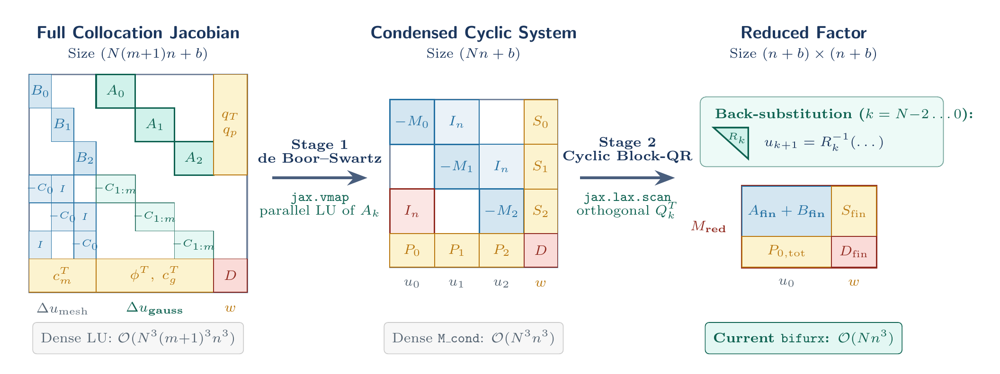

# Structured Linear Algebra for Periodic-Orbit Collocation BVPs

Solving a periodic orbit by Gauss-Legendre orthogonal collocation produces a large, sparse, nonlinear algebraic system $H_{\text{BVP}}(X, p) = 0$ of dimension $N(m+1)n + 1$, where $N$ is the number of mesh subintervals, $m$ is the number of interior Gauss-Legendre collocation points per subinterval, and $n$ is the state dimension.

During Newton correction and Keller pseudo-arclength continuation, every iteration requires solving a linear system (square or bordered) with the collocation Jacobian. A naive dense factorization scales as $\mathcal{O}\!\left((N(m+1)n)^3\right)$ in time and $\mathcal{O}\!\left((N(m+1)n)^2\right)$ in memory—prohibitive even for moderate $N$ and $n$.

In `bifurx.bvp.condensation`, this cost is reduced to **strictly linear in $N$**—$\mathcal{O}(N m^3 n^3 + N n^3)$ time and $\mathcal{O}(N m^2 n^2 + N n^2)$ memory—through a **two-stage structured elimination** implemented in pure, JIT-compiled JAX:

1. **Stage 1 (de Boor–Swartz Block Condensation)**: Parallel elimination of all interior Gauss-stage unknowns $\Delta u_{k, 1:m}$ on every subinterval via `jax.vmap(lu_factor)`.
2. **Stage 2 (Orthogonal Cyclic Block-QR Elimination)**: Numerically stable $\mathcal{O}(N n^3)$ elimination of the condensed cyclic block-bidiagonal + border system via `jax.lax.scan`, following Wright (1992) and Ascher–Mattheij–Russell (1995).

---

## 1. Structure of the Linearized Collocation System

On subinterval $k \in \{0, \dots, N-1\}$ with width $h_k = \tau_{k+1} - \tau_k$, the unknowns are the left mesh value $u_{k, 0} \in \mathbb{R}^n$ and the $m$ interior Gauss-stage values $u_{k, 1:m} \in \mathbb{R}^{mn}$, together with the scalar period $T$ (and, in pseudo-arclength continuation, the scalar continuation parameter $p$).

Linearizing the collocation BVP residual around $(X, p)$ yields three coupled groups of linear equations:

1. **Subinterval collocation equations** ($N$ decoupled local blocks of size $mn$):
   $$A_k \, \Delta u_{k, 1:m} + B_k \, \Delta u_{k, 0} + q_{T, k} \, \Delta T + q_{p, k} \, \Delta p = r_{\text{coll}, k}$$
   where
   $$(A_k)_{ij} = \frac{D_{ij}}{h_k} I_n - \delta_{ij} T \, J_u(u_{k, i}, p), \qquad (B_k)_i = \frac{D_{i0}}{h_k} I_n$$
   $$q_{T, k, i} = -f(u_{k, i}, p), \qquad q_{p, k, i} = -T \, J_p(u_{k, i}, p)$$

2. **Inter-element continuity & periodic closure** ($N$ blocks of size $n$):
   $$\Delta u_{(k+1)\bmod N, 0} - C_0 \, \Delta u_{k, 0} - \sum_{j=1}^m C_j \, \Delta u_{k, j} = r_{\text{cont}, k}$$

3. **Global scalar border equations** ($b = 1$ for fixed-$p$ solves, $b = 2$ for bordered arclength continuation):
   - **Integral phase condition**: $\sum_{k=0}^{N-1} \phi_k^T \Delta u_{k, 1:m} = r_{\text{phase}}$, where $\phi_{k, i} = h_k w_i \dot{u}_{\text{ref}}(\tau_{k, i})$.
   - **Pseudo-arclength constraint** (when $b = 2$): $\sum_{k=0}^{N-1} \left(c_{m, k}^T \Delta u_{k, 0} + c_{g, k}^T \Delta u_{k, 1:m}\right) + c_T \Delta T + d_p \Delta p = r_{\text{arc}}$.

---

## 2. Stage 1: de Boor–Swartz Block Condensation

The key observation of de Boor & Swartz (1973) is that the interior Gauss unknowns $\Delta u_{k, 1:m}$ on subinterval $k$ appear **only** inside block $k$'s collocation equations, block $k$'s continuity equation, and the $b$ global scalar rows. They never couple directly to $\Delta u_{j, 1:m}$ for $j \ne k$.

Therefore, all $N$ local $(mn) \times (mn)$ matrices $A_k$ can be LU-factored **independently in parallel** via `jax.vmap(jax.scipy.linalg.lu_factor)`:

$$K_k = A_k^{-1} B_k, \qquad \gamma_{T, k} = A_k^{-1} q_{T, k}, \qquad \gamma_{p, k} = A_k^{-1} q_{p, k}, \qquad \hat{r}_k = A_k^{-1} r_{\text{coll}, k}$$

Expressing the interior Gauss updates explicitly in terms of the mesh and scalar updates:

$$\Delta u_{k, 1:m} = \hat{r}_k - K_k \, \Delta u_{k, 0} - \gamma_{T, k} \, \Delta T - \gamma_{p, k} \, \Delta p$$

and substituting into the continuity and border rows eliminates all $Nmn$ interior variables, leaving a **condensed cyclic block-bidiagonal + border system** of size $(Nn + b) \times (Nn + b)$ for $u_{\text{mesh}} = (\Delta u_{0,0}, \dots, \Delta u_{N-1,0})$ and $w = (\Delta T[, \Delta p]) \in \mathbb{R}^b$:

$$\begin{cases}
-M_k \, u_k + u_{(k+1)\bmod N} + S_k \, w = \tilde{r}_k, & k = 0, \dots, N-1 \\[1ex]
\displaystyle\sum_{k=0}^{N-1} P_k \, u_k + D_{\text{border}} \, w = \tilde{g}
\end{cases}$$

where the subinterval transition matrix is:

$$M_k = C_0 I_n - \sum_{j=1}^m C_j K_{k, j} \in \mathbb{R}^{n \times n}$$

and $S_k \in \mathbb{R}^{n \times b}$, $P_k \in \mathbb{R}^{b \times n}$, $D_{\text{border}} \in \mathbb{R}^{b \times b}$ collect the condensed period/parameter columns and phase/arclength rows.

Once $(u_{\text{mesh}}, w)$ is obtained, $\Delta u_{k, 1:m}$ is recovered in one vectorized back-substitution pass without re-factoring $A_k$.

---

## 3. Why Naive Elimination of the Condensed System Fails

At first glance, the condensed system looks easy to collapse by forward substitution: $u_1 = M_0 u_0 + \dots$, $u_2 = M_1 M_0 u_0 + \dots$, leading to $(I_n - M_{N-1} \cdots M_0) u_0 + \dots = \dots$. In practice, **this naive elimination fails for two fundamental reasons**:

1. **Exact Singularity at Every Periodic Orbit**:
   The product $M = M_{N-1} \cdots M_1 M_0$ is the discrete **monodromy matrix** of the periodic orbit. By time-translation invariance of autonomous ODEs, $M$ always has a trivial Floquet multiplier $\mu = 1$ (with eigenvector $\dot{u}(0)$). Consequently, the unbordered cyclic block-bidiagonal operator $C_{\text{cont}}$ has a 1D nullspace, and $I_n - M$ is **singular**—one cannot invert $C_{\text{cont}}$ alone via a naive Schur complement for $w$.

2. **Exponential Dichotomy & Overflow in Stiff Systems**:
   For stiff relaxation oscillations (e.g., Van der Pol at $\mu = 10$) or long-period orbits near homoclinic connections, the monodromy product $M_{N-1} \cdots M_0$ mixes exponentially growing and decaying modes spanning tens or hundreds of orders of magnitude (e.g., $10^{+60}$ and $10^{-60}$). Forming the raw product $M_{N-1} \cdots M_0$ causes catastrophic overflow and complete loss of the decaying subspace.

---

## 4. Stage 2: $\mathcal{O}(N n^3)$ Orthogonal Block-QR Cyclic Elimination

To achieve $\mathcal{O}(N n^3)$ complexity **without** forming unscaled monodromy products and **without** ever inverting the singular unbordered block $C_{\text{cont}}$, `bifurx` implements sequential orthogonal block-QR row reduction (`factor_cyclic_block_bidiagonal` / `solve_cyclic_block_bidiagonal`), following Wright (1992) and Ascher–Mattheij–Russell (1995).

### 4.1 Forward Orthogonal Elimination (`jax.lax.scan`)
Maintain an active coupling equation linking $u_0$, the current interior node $u_{k+1}$, and the border unknowns $w$:

$$A_{\text{cur}} \, u_0 + B_{\text{cur}} \, u_{k+1} + S_{\text{cur}} \, w = r_{\text{cur}}$$

initialized at $k = 0$ with $A_{\text{cur}} = -M_0$, $B_{\text{cur}} = I_n$, $S_{\text{cur}} = S_0$.

At step $k = 0, \dots, N - 2$, pair this active equation with the next continuity row $-M_{k+1} u_{k+1} + u_{(k+2)\bmod N} + S_{k+1} w = r_{k+1}$:

$$\begin{pmatrix} A_{\text{cur}} & B_{\text{cur}} & 0 & S_{\text{cur}} \\ 0 & -M_{k+1} & I_n & S_{k+1} \end{pmatrix}
\begin{pmatrix} u_0 \\ u_{k+1} \\ u_{(k+2)\bmod N} \\ w \end{pmatrix}
= \begin{pmatrix} r_{\text{cur}} \\ r_{k+1} \end{pmatrix}$$

Compute the **complete orthogonal QR factorization** of the $2n \times n$ pivot column block:

$$\begin{pmatrix} B_{\text{cur}} \\ -M_{k+1} \end{pmatrix} = Q_k \begin{pmatrix} R_k \\ 0 \end{pmatrix}, \qquad Q_k \in \mathbb{R}^{2n \times 2n}, \quad R_k \in \mathbb{R}^{n \times n} \text{ upper triangular}$$

Multiplying both rows on the left by $Q_k^T$ decouples $u_{k+1}$ cleanly into the top $n$ rows while producing the next active equation in the bottom $n$ rows:

$$\begin{aligned}
R_k \, u_{k+1} + E_k \, u_0 + F_k \, u_{(k+2)\bmod N} + G_k \, w &= r_{\text{top}, k} && \text{(saved for back-substitution)} \\
A_{\text{new}} \, u_0 + B_{\text{new}} \, u_{(k+2)\bmod N} + S_{\text{new}} \, w &= r_{\text{new}} && \text{(carried to step } k + 1\text{)}
\end{aligned}$$

Simultaneously, eliminate $u_{k+1}$ from the $b$ global border rows using $W_k = P_{\text{cur}} R_k^{-1}$ (computed via `solve_triangular`):

$$P_0 \leftarrow P_0 - W_k E_k, \qquad P_{\text{cur}} \leftarrow P_{k+2} - W_k F_k, \qquad D_{\text{border}} \leftarrow D_{\text{border}} - W_k G_k$$

Because every elimination step applies an **orthogonal matrix $Q_k^T$**, the 2-norm conditioning of the active rows is preserved at every interval—even when $\prod M_k$ has eigenvalues $10^{\pm 60}$.

### 4.2 Tiny $(n + b) \times (n + b)$ Reduced System & Back-Substitution
After $N - 1$ steps, $u_{(k+2)\bmod N}$ wraps around to $u_0$, collapsing the entire $(Nn + b) \times (Nn + b)$ system into a tiny **nonsingular** $(n + b) \times (n + b)$ reduced system coupling only $(u_0, w)$:

$$M_{\text{red}} \begin{pmatrix} u_0 \\ w \end{pmatrix} = \begin{pmatrix} A_{\text{fin}} + B_{\text{fin}} & S_{\text{fin}} \\ P_{0, \text{fin}} + P_{\text{cur}, \text{fin}} & D_{\text{fin}} \end{pmatrix} \begin{pmatrix} u_0 \\ w \end{pmatrix} = \begin{pmatrix} r_{\text{fin}} \\ g_{\text{fin}} \end{pmatrix}$$

`M_red` is factored with LU (`lu_factor`) with an automatic `lstsq` fallback if its diagonal conditioning falls below `rcond`. Once $(u_0, w)$ is solved, a reverse `jax.lax.scan` recovers $u_{N-1}, \dots, u_1$ by upper-triangular solves:

$$R_k \, u_{k+1} = r_{\text{top}, k} - E_k u_0 - F_k u_{(k+2)\bmod N} - G_k w$$

This works identically for **any** $N \ge 1$ (no power-of-2 restriction) and never allocates an $(Nn) \times (Nn)$ array anywhere in the JAX computation graph.

---

## 5. Complexity & Memory Scaling

| Method | Factorization Time | Solve Time (Reused Factor) | Memory | Dense $(Nn)^2$ Allocation? |
| :--- | :--- | :--- | :--- | :---: |
| **Full Dense Collocation LU** | $\mathcal{O}\!\left(N^3 (m+1)^3 n^3\right)$ | $\mathcal{O}\!\left(N^2 (m+1)^2 n^2\right)$ | $\mathcal{O}\!\left(N^2 (m+1)^2 n^2\right)$ | Yes |
| **Stage 1 Only (Dense `M_cond`)** | $\mathcal{O}\!\left(N m^3 n^3 + N^3 n^3\right)$ | $\mathcal{O}\!\left(N m^2 n^2 + N^2 n^2\right)$ | $\mathcal{O}\!\left(N m^2 n^2 + N^2 n^2\right)$ | Yes |
| **Stage 1 + Stage 2 (Current `bifurx`)** | $\mathcal{O}\!\left(N (m^3 + 1) n^3 + (n+b)^3\right)$ | $\mathcal{O}\!\left(N (m^2 + 1) n^2 + (n+b)^2\right)$ | $\mathcal{O}\!\left(N (m^2 + 4) n^2\right)$ | **No** |

---

## 6. Implementation Mapping in `bifurx`

| Component | Symbol in `bifurx.bvp.condensation` | Role |
| :--- | :--- | :--- |
| Structured cyclic factor | `CyclicBlockBidiagonalFactor` | PyTree `NamedTuple` storing $(Q, R, E, G, W)$ and reduced $(n+b)\times(n+b)$ factor |
| Stage 2 factorization | `factor_cyclic_block_bidiagonal` | $\mathcal{O}(N n^3)$ orthogonal block-QR elimination via `jax.lax.scan` |
| Stage 2 solve | `solve_cyclic_block_bidiagonal` | Forward orthogonal sweep + reduced LU/`lstsq` + reverse triangular back-substitution |
| Full 2-stage factor | `factor_condensed_collocation` | Parallel `vmap` Stage 1 condensation + Stage 2 cyclic factorization |
| Square / Bordered solves | `solve_condensed_collocation`, `solve_condensed_bordered` | Reusable solves for `solve_periodic_orbit` and `track_arclength_scan` |
| Homotopy bridge | `make_collocation_bordered_solver` | Plugs directly into `bifurx.homotopy.BorderedOperatorSolver` |

---

## References

1. C. de Boor & B. Swartz, *Collocation at Gaussian points*, SIAM J. Numer. Anal. **10**(4), 582–606 (1973).
2. S. J. Wright, *Stable parallel algorithms for two-point boundary value problems*, SIAM J. Sci. Stat. Comput. **13**(3), 742–764 (1992).
3. U. M. Ascher, R. M. M. Mattheij & R. D. Russell, *Numerical Solution of Boundary Value Problems for Ordinary Differential Equations*, SIAM Classics in Applied Mathematics (1995).
4. E. J. Doedel et al., *AUTO-07P: Continuation and Bifurcation Software for Ordinary Differential Equations* (2007).
