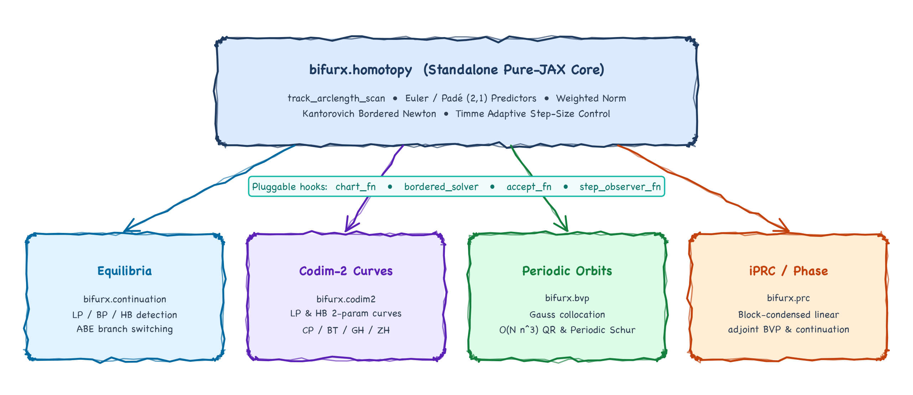

# Applying Homotopy Continuation to Dynamical Systems

Consider a parameterized autonomous continuous-time dynamical system:

$$\frac{du}{dt} = f(u, p), \quad u \in \mathbb{R}^n, \quad p \in \mathbb{R}^d$$

Understanding the global qualitative behavior of such a system requires tracking not only stationary states (equilibria), but also **bifurcation curves in two-parameter space**, **periodic orbits (limit cycles)**, and **phase sensitivity curves (iPRCs)**.

The central architectural principle of `bifurx` is that **all of these dynamical-systems problems reduce to smooth 1D continuation problems $H(U, \lambda) = 0$** solved by the general homotopy engine [`bifurx.homotopy.track_arclength_scan`](homotopy_continuation.md).

---

## 1. Unified Architecture: From $\dot{u} = f(u, p)$ to $H(U, \lambda) = 0$

The table below maps each dynamical-systems module in `bifurx` directly onto the hooks of the general homotopy core:

| Dynamical Systems Problem | Module | Unknowns $U$ & Parameter $\lambda$ | Moving Chart (`chart_fn`) | Linear Backend (`bordered_solver`) | Step Observer (`step_observer_fn`) |
| :--- | :--- | :--- | :--- | :--- | :--- |
| **Equilibria** $f(u, p) = 0$ | `bifurx.continuation` | $U = u \in \mathbb{R}^n$, $\lambda = p$ | None | Dense Block/Direct LU (or GMRES) | Eigenvalues of $J_u$; LP, BP, HB test functions |
| **Codim-2 Fold (LP) Curve** | `bifurx.codim2` | $U = (u, p_1, v) \in \mathbb{R}^{2n+1}$, $\lambda = p_2$ | None | Dense Bordered LU | CP, BT, ZH singularity diagnostics |
| **Codim-2 Hopf (HB) Curve** | `bifurx.codim2` | $U = (u, p_1, v_r, v_i, \omega) \in \mathbb{R}^{3n+2}$, $\lambda = p_2$ | None | Dense Bordered LU | GH ($l_1$), BT, ZH singularity diagnostics |
| **Periodic Orbits (Limit Cycles)** | `bifurx.bvp` | $U = (u_{\text{mesh}}, u_{\text{gauss}}, T)$, $\lambda = p$ | Phase reference $\dot{u}_{\text{ref}}$ | de Boor-Swartz Block Condensation | Monodromy matrix $M$ & Floquet multipliers (LPC, PD, NS) |
| **iPRC Continuation** | `bifurx.prc` | Periodic orbit $U$ + linear adjoint $Z(t)$ | Phase reference $\dot{u}_{\text{ref}}$ | Condensed BVP + Linear Adjoint Solve | Peak sensitivity & zero crossings |

---

## 2. Equilibrium Continuation & Codim-1 Bifurcations (`bifurx.continuation`, `bifurx.bifurcations`)

### 2.1 Equilibrium Formulation
Equilibria of $\dot{u} = f(u, p)$ satisfy the algebraic system:

$$H(u, p) \equiv f(u, p) = 0, \quad u \in \mathbb{R}^n, \quad p \in \mathbb{R}$$

Wrapped in a `BifurcationProblem` PyTree, `continuation_scan` and `continuation` invoke `track_arclength_scan` with `jax.jacobian` providing exact derivatives $J_u = \nabla_u f$ and $J_p = \nabla_p f$.

### 2.2 Stability & Test Functions in the Step Observer
At every accepted continuation point $(u_k, p_k)$ with unit tangent $\tau_k = (\dot{u}_k, \dot{p}_k)$, the step observer (`evaluate_point_diagnostics`) computes the spectrum $\operatorname{spec}(J_u(u_k, p_k))$:
- **Linear stability**: $\operatorname{Re}(\lambda_i) < 0$ for all $i = 1, \dots, n$.
- **Limit Point / Fold (LP)**: $\psi_{\text{LP}} = \dot{p}_k$.
- **Branch Point (BP)**: $\psi_{\text{BP}} = \det \begin{pmatrix} J_u & J_p \\ \dot{u}_k^T & \dot{p}_k \end{pmatrix}$ (the bordered Jacobian determinant, which changes sign at simple branch points without firing at folds).
- **Hopf Bifurcation (HB)**: $\psi_{\text{HB}} = \max \{ \operatorname{Re}(\lambda) : |\operatorname{Im}(\lambda)| > \epsilon_{\text{rel}} (1 + |\lambda|) \}$.

When a test function changes sign between consecutive steps, `continuation` refines the exact bifurcation point (`refine_bifurcation_point`) and enables branch switching via the **Algebraic Bifurcation Equation (ABE)** (`switch_branch`). See [Bifurcation Theory & Branch Switching](bifurcations.md) for the complete derivations.

---

## 3. Two-Parameter Continuation of Codimension-2 Curves (`bifurx.codim2`)

When a dynamical system depends on **two parameters** $(p_1, p_2)$, codimension-1 bifurcations (Folds and Hopf points) no longer appear as isolated points—they form **1D curves in the $(p_1, p_2)$-plane**.

`bifurx.codim2.continuation_codim2` tracks these curves by promoting the defining equations of the codim-1 singularity into an augmented system $H(U, p_2) = 0$ and feeding it directly into `track_arclength_scan`.

### 3.1 Fold (LP) Curve Continuation
Appending the singularity condition $J_u v = 0$ and normalization $\langle l, v \rangle = 1$ yields the $(2n+1)$-dimensional **Moore-Spence defining system** for $U = (u, p_1, v) \in \mathbb{R}^{2n+1}$ parameterized by $p_2$:

$$H_{\text{LP}}(u, p_1, v; p_2) = \begin{pmatrix} f(u, p_1, p_2) \\ \nabla_u f(u, p_1, p_2) \, v \\ \langle l, v \rangle - 1 \end{pmatrix} = 0$$

### 3.2 Hopf (HB) Curve Continuation
For $n = 2$, a Hopf point satisfies $\operatorname{tr}(J_u) = 0$ with $\det(J_u) > 0$, giving the compact 3D system $H_{\text{HB}}(u, p_1; p_2) = (f(u, p_1, p_2), \; \operatorname{tr}(J_u)) = 0$.

For general dimension $n \ge 3$, separating the complex eigenpair $J_u (v_r + i v_i) = i \omega (v_r + i v_i)$ into real and imaginary parts gives the $(3n+2)$-dimensional **Hopf defining system** for $U = (u, p_1, v_r, v_i, \omega)$:

$$H_{\text{HB}}(u, p_1, v_r, v_i, \omega; p_2) = \begin{pmatrix} f(u, p_1, p_2) \\ J_u v_r + \omega v_i \\ J_u v_i - \omega v_r \\ \langle l_R, v_r \rangle - 1 \\ \langle l_R, v_i \rangle \end{pmatrix} = 0$$

### 3.3 Codimension-2 Singularity Detection
As `track_arclength_scan` traces the LP or HB curve, `continuation_codim2` monitors higher-codimension test functions along the curve:

| Singularity | Curve | Defining Condition | Test Function |
| :--- | :--- | :--- | :--- |
| **Cusp (CP)** | LP | Quadratic coefficient vanishes: $\frac{1}{2}\langle w, D^2_{uu} f[v, v]\rangle = 0$ | $\psi_{\text{CP}} = \frac{1}{2}\langle w, D^2_{uu} f(u)[v, v] \rangle$ ($w \in \ker J_u^T$) |
| **Bogdanov-Takens (BT)** | LP / HB | Double zero eigenvalue ($\lambda_{1,2} = 0$, Jordan block) | $\langle w, v \rangle = 0$ (LP); $\det(J_u) = 0$ ($n=2$) or $\omega = 0$ ($n\ge 3$) (HB) |
| **Generalized Hopf / Bautin (GH)** | HB | First Lyapunov coefficient vanishes (supercritical $\leftrightarrow$ subcritical) | $l_1(u, p_1, p_2) = 0$ (`compute_first_lyapunov_coefficient`) |
| **Zero-Hopf (ZH)** | LP / HB ($n \ge 3$) | Simultaneous zero eigenvalue and imaginary pair $\pm i\omega$ | $\psi_{\text{HB}}(J_u) = 0$ on LP, or $\det(J_u) = 0$ on HB |

See [Bifurcation Theory & Branch Switching](bifurcations.md) for the complete derivations of Kuznetsov's $l_1$, the codimension-2 test functions, canonical Hopf eigenvector normalization, and continuous SVD null-vector sign alignment.

---

## 4. Periodic Orbits as Collocation BVPs (`bifurx.bvp`)

Unlike equilibria, a **limit cycle** (periodic orbit) is a closed trajectory $u(t + T) = u(t)$ of unknown period $T > 0$. By rescaling time $t = T \tau$ to the fixed unit interval $\tau \in [0, 1]$, finding a periodic orbit becomes a **Two-Point Boundary Value Problem (TPBVP)**:

$$\begin{cases}
\dfrac{du}{d\tau} - T f(u(\tau), p) = 0, & \tau \in [0, 1] \\[1ex]
u(1) - u(0) = 0 & \text{(periodicity)} \\[1ex]
\displaystyle\int_0^1 \langle \dot{u}_{\text{ref}}(\tau), u(\tau) \rangle \, d\tau = 0 & \text{(Poincaré integral phase condition)}
\end{cases}$$

The Poincaré integral phase condition removes the continuous time-translation symmetry $u(\tau) \mapsto u(\tau + \phi)$ of autonomous ODEs, anchoring the orbit uniquely relative to a reference velocity $\dot{u}_{\text{ref}}(\tau)$.

### 4.1 Gauss-Legendre Orthogonal Collocation (`bvp.collocation`)
Partition $[0, 1]$ into $N$ subintervals $0 = \tau_0 < \tau_1 < \dots < \tau_N = 1$ with widths $h_k = \tau_{k+1} - \tau_k$. On each subinterval $k$, approximate $u(\tau)$ by a degree-$m$ polynomial interpolated at the left mesh node $\xi_0 = 0$ and $m$ **Gauss-Legendre interior nodes** $\rho_1 < \dots < \rho_m \in (0, 1)$:

$$u_k(\tau) = L_0(\xi) u_{k, 0} + \sum_{j=1}^m L_j(\xi) u_{k, j}, \quad \xi = \frac{\tau - \tau_k}{h_k}$$

Collecting the unknowns into a single flat vector $X = (u_{\text{mesh}}, u_{\text{gauss}}, T) \in \mathbb{R}^{N(m+1)n + 1}$, the discretized BVP residual $H_{\text{BVP}}(X, p) = 0$ consists of:
1. **$N m n$ collocation equations**:
   $$\frac{1}{h_k} \sum_{j=0}^m D_{ij} u_{k, j} - T f(u_{k, i}, p) = 0, \quad k = 0, \dots, N-1, \; i = 1, \dots, m$$
2. **$N n$ continuity & periodic closure equations**:
   $$u_{(k+1)\bmod N, 0} - \sum_{j=0}^m C_j u_{k, j} = 0, \quad k = 0, \dots, N-1$$
3. **1 discretized integral phase condition**:
   $$\sum_{k=0}^{N-1} h_k \sum_{i=1}^m w_i \langle \dot{u}_{\text{ref}}(\tau_{k, i}), u_{k, i} \rangle = 0$$

By the **de Boor-Swartz theorem** (1973), Gauss-Legendre collocation achieves **superconvergence** of order $\mathcal{O}(h^{2m})$ at the mesh nodes (e.g., $\mathcal{O}(h^8)$ for the default $m = 4$).

### 4.2 Connecting Periodic Orbits to `track_arclength_scan`
`continue_periodic_orbit` runs `track_arclength_scan` directly on $H_{\text{BVP}}(X, p) = 0$ by supplying four domain-specific components:

1. **Moving Local Phase Chart (`chart_fn`)**:
   After each accepted step, `chart_fn` updates $\dot{u}_{\text{ref}}$ from the newly converged orbit's polynomial derivative $\frac{1}{h_k} D U_k$, ensuring the phase condition remains well-conditioned even as the limit cycle deforms dramatically.

2. **$L^2$-Weighted Arclength Metric (`periodic_orbit_arclength_weights`)**:
   A naive Euclidean norm on $X$ would over-weight densely meshed regions. `bifurx` instead defines diagonal quadrature weights approximating the continuous $L^2([0, 1])$ inner product plus period and parameter weights:
   $$\|\Delta X, \Delta p\|_{W_{\text{arc}}}^2 = \sum_{k=0}^{N-1} h_k \sum_{i=1}^m w_i \|\Delta u_{k, i}\|_2^2 + w_T^2 (\Delta T)^2 + w_p^2 (\Delta p)^2$$

3. **Two-Stage Block Condensation & $\mathcal{O}(N n^3)$ Cyclic Block-QR Solver (`bvp.condensation`)**:
   A dense factorization of the full collocation Jacobian costs $\mathcal{O}((N(m+1)n)^3)$. However, the interior Gauss variables $u_{k, 1:m}$ on subinterval $k$ couple **only** to the left endpoint $u_{k, 0}$, $T$, and $p$:
   $$A_k \, \Delta u_{k, 1:m} + B_k \, \Delta u_{k, 0} + q_{T, k} \, \Delta T + q_{p, k} \, \Delta p = r_{k}$$
   `make_collocation_bordered_solver` implements a `BorderedOperatorSolver` that first eliminates all interior Gauss variables in parallel via `jax.vmap(lu_factor)` (de Boor–Swartz condensation), and then solves the resulting cyclic block-bidiagonal + border system in $\mathcal{O}(N n^3)$ time and $\mathcal{O}(N n^2)$ memory via sequential orthogonal block-QR elimination (`jax.lax.scan`)—never allocating an $(Nn) \times (Nn)$ dense matrix. See [Structured Linear Algebra for Collocation BVPs](collocation_condensation.md) for the complete derivation.

4. **Floquet Multipliers, Periodic Real Schur & Orbit Bifurcations (`bvp.floquet`)**:
   The exact same local block elimination yields the per-interval transition matrices $M_k = C_0 I_n - \sum_{j=1}^m C_j K_{k, j}$ (`monodromy_factors_condensation`), whose cyclic product is the **monodromy matrix** $M = M_{N-1} \cdots M_1 M_0 \in \mathbb{R}^{n \times n}$. To avoid overflow or roundoff loss on stiff or long-period orbits, `continue_periodic_orbit(..., compute_floquet=True)` uses the pure-JAX **Periodic Real Schur decomposition** (`floquet_method="periodic_qr"`, default) via `evaluate_floquet_diagnostics_from_factors`—extracting multipliers and real Floquet exponents $\sigma_i = \frac{1}{T}\log|\mu_i|$ directly from $\{M_k\}$ without ever multiplying them. See [Periodic Real Schur for Stiff Floquet Analysis](periodic_schur_floquet.md).

   The eigenvalues $\mu_1, \dots, \mu_n$ of $M$ are the **Floquet multipliers**. Every autonomous periodic orbit has a trivial multiplier $\mu_1 = 1$; the orbit is linearly stable if $|\mu_j| < 1$ for all $j \ge 2$. Periodic-orbit bifurcations are detected via:
   - **Limit Point of Cycles / Fold (LPC)**: $\psi_{\text{LPC}} = \dot{p} = 0$ (multiplier crosses $+1$).
   - **Period-Doubling / Flip (PD)**: $\psi_{\text{PD}} = \det(M + I_n) = 0$ (multiplier crosses $-1$).
   - **Neimark-Sacker / Torus (NS)**: $\psi_{\text{NS}} = \max_{\operatorname{Im}(\mu) \ne 0} (|\mu| - 1) = 0$ (complex pair crosses the unit circle).

### 4.3 Hopf Initialization & Adaptive Remeshing
- **Branching from Hopf (`initialize_from_hopf`)**: At a Hopf bifurcation $(u^*, p^*)$ with eigenpair $J_u v = i \omega v$, `bifurx` seeds the small-amplitude periodic orbit $u(\tau) \approx u^* + \varepsilon \operatorname{Re}(v e^{2\pi i \tau})$, $T \approx 2\pi / \omega$ and converges it via `solve_periodic_orbit`.
- **Adaptive Mesh Redistribution (`bvp.mesh.redistribute_mesh`)**: For stiff relaxation oscillations or orbits approaching homoclinic connections, `continue_periodic_orbit` supports periodic remeshing (`remesh_interval`) between `lax.scan` chunks, equidistributing the monitor function $w(\tau) = \sqrt{1 + \alpha \|\dot{u}(\tau)\|^2 + \beta \|\ddot{u}(\tau)\|^{2/3}}$ (analogous to AUTO-07P's `ADPTDS`).
- **Hamiltonian Systems**: In conservative systems such as the Circular Restricted Three-Body Problem, energy conservation induces a 1-parameter family of periodic orbits at fixed physical parameters. See [CR3BP & KAM Torus Theory](cr3bp_kam.md) for Hamiltonian continuation and symplectic Floquet theory.

---

## 5. Phase Reduction & iPRC Continuation (`bifurx.prc`)

Given a converged periodic orbit $(u^*(\tau), T)$ at parameter $p$, its **infinitesimal Phase Response Curve (iPRC)** $Z(\tau) = \nabla_u \theta(u^*(\tau))$ satisfies the linear periodic adjoint BVP:

$$\frac{dZ}{d\tau} + T \left[\nabla_u f(u^*(\tau), p)\right]^T Z(\tau) = 0, \quad Z(1) = Z(0), \quad \langle Z(0), f(u^*(0), p) \rangle = \frac{2\pi}{T}$$

In `bifurx.prc`, this adjoint BVP is discretized on the **exact same Gauss-Legendre collocation mesh** as the limit cycle, with a rank-1 bordered normalization ensuring nonsingularity regardless of which velocity component vanishes at $\tau = 0$. `continuation_iprc` couples this direct linear adjoint solve with `continue_periodic_orbit` to trace the full family $(u^*(p), T(p), Z(p))$ across parameter space. See [Phase Reduction Theory & iPRC](prc_theory.md) for the complete mathematical derivation and neuroscientific applications.
