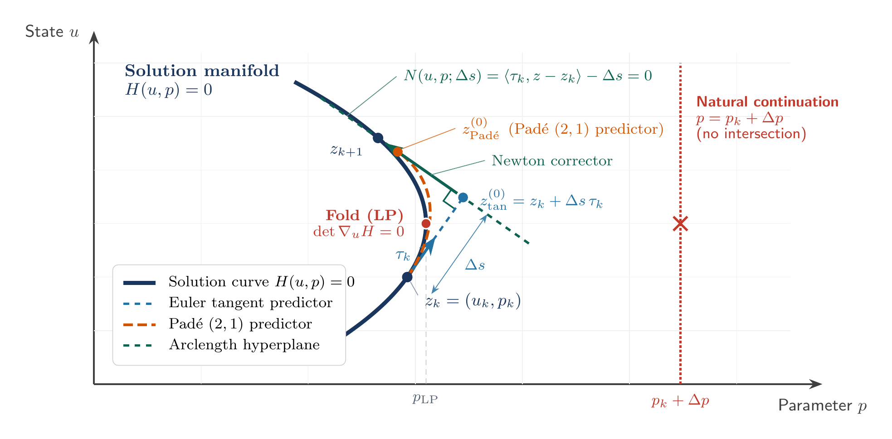
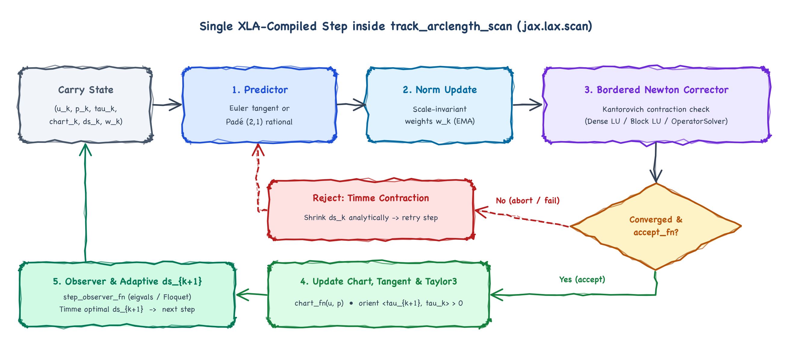
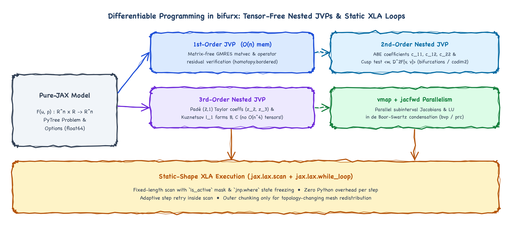

# Homotopy Continuation: General Theory & Path-Tracking Core

Numerical **homotopy continuation** traces smooth one-dimensional solution manifolds of underdetermined nonlinear systems:

$$H(u, p) = 0, \quad u \in \mathbb{R}^n, \quad p \in \mathbb{R}$$

where $H: \mathbb{R}^n \times \mathbb{R} \to \mathbb{R}^n$ is a smooth ($C^k, k \ge 3$) nonlinear residual map.

In `bifurx`, all continuation workflows—equilibria, codimension-2 bifurcation curves, periodic-orbit collocation BVPs, and phase response curves—are built on top of a single, standalone, pure-JAX path-tracking core in **`bifurx.homotopy`**. This page presents the general mathematical theory behind that core, following the exact module structure of `bifurx.homotopy`:

1. **Implicit 1-Manifolds & Keller Pseudo-Arclength Parameterization** (`homotopy.tracker`)
2. **Scale-Invariant Weighted Norms** (`homotopy.norm`)
3. **Predictors: Euler Tangent & Padé (2,1) Rational Approximation** (`homotopy.predictor`)
4. **Bordered Linear Solvers & Pluggable Operator Backends** (`homotopy.bordered`)
5. **Affine-Invariant Bordered Newton Corrector** (`homotopy.corrector`)
6. **Theory-Grounded Adaptive Step-Size Control (Timme, 2020)** (`homotopy.stepsize`)
7. **Moving Local Charts & `jax.lax.scan` Path Tracking** (`homotopy.tracker`)

---

## 1. Implicit 1-Manifolds & Pseudo-Arclength Parameterization

Let $z = (u, p) \in \mathbb{R}^{n+1}$ denote the combined state-parameter vector, and let the total Jacobian be:

$$DH(z) = \begin{bmatrix} \nabla_u H(u, p) & \nabla_p H(u, p) \end{bmatrix} \in \mathbb{R}^{n \times (n+1)}$$

If $0 \in \mathbb{R}^n$ is a regular value of $H$ (i.e., $\operatorname{rank} DH(z) = n$ along the solution set), the **Implicit Function Theorem** guarantees that the zero set $H^{-1}(0)$ is a smooth 1-dimensional manifold consisting of disjoint curves (arcs and closed loops).

### 1.1 Failure of Natural Parameter Continuation
In **natural parameter continuation**, the parameter $p$ is incremented directly ($p_{k+1} = p_k + \Delta p$) and $H(u, p_{k+1}) = 0$ is solved for $u_{k+1}$ via Newton's method:

$$\nabla_u H(u^{(i)}, p_{k+1}) \Delta u^{(i)} = -H(u^{(i)}, p_{k+1})$$

Differentiating $H(u(p), p) = 0$ with respect to $p$ yields:

$$\nabla_u H(u, p) \frac{du}{dp} + \nabla_p H(u, p) = 0 \implies \frac{du}{dp} = -\left[\nabla_u H(u, p)\right]^{-1} \nabla_p H(u, p)$$

At a **fold / turning point (limit point)** where the curve turns back with respect to $p$, $\nabla_u H$ becomes singular ($\det \nabla_u H = 0$) and $\|du / dp\| \to \infty$. Natural parameter continuation cannot step past such folds.

### 1.2 Keller Pseudo-Arclength Formulation
Following Herbert B. Keller (1977), we parameterize both $u$ and $p$ by an intrinsic arclength parameter $s \in \mathbb{R}$:

$$s \mapsto z(s) = \begin{pmatrix} u(s) \\ p(s) \end{pmatrix} \in \mathbb{R}^{n+1}$$

Differentiating $H(z(s)) = 0$ with respect to $s$ gives the tangent equation:

$$DH(z(s)) \, \tau(s) = \nabla_u H(u, p) \dot{u} + \nabla_p H(u, p) \dot{p} = 0, \quad \tau = \begin{pmatrix} \dot{u} \\ \dot{p} \end{pmatrix} \in \ker DH(z)$$

normalized in a weighted inner product with positive diagonal weights $W_{\text{arc}} = \operatorname{diag}(w_{\text{arc}}) \succ 0$ (defaulting to the Euclidean identity $W_{\text{arc}} = I_{n+1}$):

$$\|\tau\|_{W_{\text{arc}}}^2 = \langle W_{\text{arc}} \tau, \tau \rangle = 1$$

To advance by step size $\Delta s$ from a known regular point $z_k = (u_k, p_k)$ with unit tangent $\tau_k = (\dot{u}_k, \dot{p}_k)$, we append a single affine hyperplane constraint:

$$N(u, p; \Delta s) = \langle c, u - u_k \rangle + d (p - p_k) - \Delta s = 0$$

This unified linear border $(c, d) \in \mathbb{R}^n \times \mathbb{R}$ encompasses all continuation modes in `bifurx.homotopy`:

| Mode | Border $(c, d)$ | Geometric Meaning |
| :--- | :--- | :--- |
| **Euclidean Pseudo-Arclength** | $c = \dot{u}_k, \; d = \dot{p}_k$ | Hyperplane orthogonal to $\tau_k$ in $\mathbb{R}^{n+1}$ |
| **Weighted Pseudo-Arclength** | $c = w_{\text{arc}, u} \odot \dot{u}_k, \; d = w_{\text{arc}, p} \dot{p}_k$ | Hyperplane orthogonal in a function-space metric (e.g., $L^2$ for periodic BVPs) |
| **Natural Parameter** (`param_mode="natural"`) | $c = 0, \; d = \pm 1$ | Fixed parameter slice $p = p_k \pm \Delta s$ (with optional `p_target` landing) |

At a regular fold point, $\nabla_u H$ is singular, yet the $(n+1) \times (n+1)$ **bordered Jacobian**

$$M(z) = \begin{pmatrix} \nabla_u H(u, p) & \nabla_p H(u, p) \\ c^T & d \end{pmatrix}$$

remains nonsingular because $\nabla_p H \notin \operatorname{Range}(\nabla_u H)$ and $c = \dot{u}_k$ has a nonzero component along $\ker(\nabla_u H)$.

---

## 2. Scale-Invariant Weighted Norm (`bifurx.homotopy.norm`)

Real physical and BVP systems often combine state variables and parameters spanning many orders of magnitude (e.g., concentrations, temperatures, periods, and dimensionless bifurcation parameters). Using an unweighted Euclidean norm makes error estimates, Kantorovich convergence checks, and step sizes sensitive to arbitrary unit rescaling.

Following Timme (2020), `bifurx.homotopy.norm` defines a **dynamic component-wise weighted infinity norm**:

$$\|v\|_w = \|D^{-1} v\|_\infty = \max_{1 \le i \le n+1} \frac{|v_i|}{w_i}, \quad D = \operatorname{diag}(w_1, \dots, w_{n+1})$$

At initialization from $z_0 = (u_0, p_0)$, the weights are set from the component magnitudes clamped to safe relative and absolute bounds (`WeightedNormOptions`):

$$w_{0, i} = \max\!\left(\operatorname{clip}\!\left(|z_{0, i}|, \; s_{\min} \|z_0\|_\infty, \; s_{\max} \|z_0\|_\infty\right), \; s_{\text{abs,min}}\right)$$

At each step, weights are updated smoothly from the predicted iterate $z_{\text{pred}}$ via an exponential moving average:

$$w_{k+1, i} = \max\!\left(\operatorname{clip}\!\left(\tfrac{1}{2}(|z_{\text{pred}, i}| + w_{k, i}), \; s_{\min} \|z_{\text{pred}}\|_\infty, \; s_{\max} \|z_{\text{pred}}\|_\infty\right), \; s_{\text{abs,min}}\right)$$

All predictor local errors, Newton step norms, contraction ratios, and Padé trust regions are evaluated in $\|\cdot\|_w$, rendering the tracker **scale-invariant**.

---

## 3. Predictors: Tangent & Padé (2,1) Rational Approximation (`bifurx.homotopy.predictor`)

Given a converged point $z_k = (u_k, p_k)$ and tangent $\tau_k$, the predictor proposes an initial guess $z^{(0)}(\Delta s)$ for the Newton corrector. `bifurx.homotopy` provides two predictors:

### 3.1 Euler Tangent Predictor (`predictor="tangent"`)
The classical first-order linear extrapolation (local truncation error $\mathcal{O}(\Delta s^2)$, order $q = 2$):

$$z^{(0)}(\Delta s) = z_k + \Delta s \, \tau_k$$

### 3.2 Third-Order Arclength Taylor & Padé (2,1) Predictor (`predictor="pade21"`)
Near high-curvature regions, tight folds, or nearby complex singularities (branch points in the complexified parameter plane), linear prediction forces tiny steps. A **Padé (2,1) rational approximant** captures both curvature and nearby poles with local error $\mathcal{O}(\Delta s^4)$ (order $q = 4$).

Consider the local curve $z(s) = z_0 + z_1 s + z_2 s^2 + z_3 s^3 + \mathcal{O}(s^4)$ satisfying $H(z(s)) = 0$ and $\langle c, u(s) - u_0 \rangle + d(p(s) - p_0) = s$, where $z_1 = \tau_k$. Differentiating $H(z(s)) = 0$ twice and three times at $s = 0$ yields two linear bordered systems sharing the **exact same** bordered Jacobian $M(z_0)$:

$$M(z_0) z_2 = \begin{pmatrix} -\tfrac{1}{2} D^2 H(z_0)[z_1, z_1] \\ 0 \end{pmatrix}$$

$$M(z_0) z_3 = \begin{pmatrix} -D^2 H(z_0)[z_1, z_2] - \tfrac{1}{6} D^3 H(z_0)[z_1, z_1, z_1] \\ 0 \end{pmatrix}$$

In `compute_arclength_taylor3`:
1. The directional derivatives $D^2 H[z_1, z_1]$ and $D^3 H[z_1, z_1, z_1]$ are computed **analytically and matrix-free** in a single pass via nested forward-mode `jax.jvp` along the 1D scalar map $t \mapsto H(z_0 + t z_1)$.
2. $M(z_0)$ is factored **once**, solving for $z_2$, then evaluating $D^2 H[z_1, z_2]$ via nested `jax.jvp` and back-substituting for $z_3$.

From $(z_0, z_1, z_2, z_3)$, the **component-wise Padé (2,1) predictor** (`pade21_predict`) evaluates:

$$z_{\text{Padé}, i}(\Delta s) = z_{0, i} + \Delta s \left( z_{1, i} + \frac{\Delta s \, z_{2, i}}{1 - \Delta s \, (z_{3, i} / z_{2, i})} \right)$$

Whenever $z_{2, i}$ or $z_{3, i}$ is negligible relative to the local scale or the denominator $|1 - \Delta s (z_{3, i}/z_{2, i})| < 0.1$ approaches a pole, that component automatically falls back to the quadratic Taylor polynomial $z_{0, i} + \Delta s (z_{1, i} + \Delta s \, z_{2, i})$.

#### Scale-Invariant Padé Trust Region
The pole location of the Padé approximant estimates the distance to the nearest complex singularity (such as a nearby bifurcation or fold). Using the weighted norms $n_k = \|z_k\|_w$, `estimate_pade_trust_region` computes:

$$\tau_{\text{TR}} = \frac{\|z_2\|_w}{\|z_3\|_w}$$

(returning $+\infty$ if the higher-order terms are numerically negligible). This trust region directly caps the step size in the adaptive controller.

---

## 4. Bordered Linear Solvers & Pluggable Operators (`bifurx.homotopy.bordered`)

Every tangent update, Taylor coefficient solve, and Newton correction reduces to a bordered linear system:

$$\begin{pmatrix} A & b \\ c^T & d \end{pmatrix} \begin{pmatrix} x \\ y \end{pmatrix} = \begin{pmatrix} f \\ g \end{pmatrix}$$

where $A \in \mathbb{R}^{n \times n}$, $b, c, f \in \mathbb{R}^n$, and $d, g, y \in \mathbb{R}$.

### 4.1 Dense Solvers
1. **Block LU / Schur Complement (`method="block"`)**:
   When $A$ is well-conditioned, factorize $A$ once and solve $A v = b$ and $A w = f$:
   $$\delta = d - c^T v, \qquad y = \frac{g - c^T w}{\delta}, \qquad x = w - y v$$
2. **Direct Bordered LU with SVD/Least-Squares Fallback (`method="direct"`)**:
   Assemble $M = \begin{pmatrix} A & b \\ c^T & d \end{pmatrix}$ and factorize with partial-pivoting LU (`lu_factor`). If the diagonal of $U$ (or singular values of $M$) indicates ill-conditioning, fall back smoothly inside XLA (`jax.lax.cond`) to minimum-norm SVD least-squares (`jnp.linalg.lstsq`).
3. **Automatic Strategy (`method="auto"`)**:
   Uses reusable LU factorization and automatically verifies a row/column-scale-invariant linear residual consistency check, retrying with `lstsq` only if accuracy degrades.

### 4.2 Pluggable `BorderedOperatorSolver` Abstraction
For large or structured systems (such as high-dimensional PDEs or periodic-orbit collocation BVPs), forming a dense $(n+1) \times (n+1)$ Jacobian is prohibitive. `bifurx.homotopy.bordered` defines a functional `BorderedOperatorSolver(factor, solve)` interface:
- **`factor(u, p, c, d) -> fac`**: Performs any reusable setup/factorization at $(u, p)$ with border $(c, d)$.
- **`solve(fac, f, g) -> BorderedSolution(x, y)`**: Solves for any right-hand side $(f, g)$ reusing `fac`.

This abstraction powers two specialized backends out of the box:
- **Matrix-Free GMRES (`make_gmres_bordered_solver`)**: Evaluates the bordered matrix-vector product via forward-mode `jax.jvp` without ever materializing $A$, solving with `jax.scipy.sparse.linalg.gmres`.
- **de Boor-Swartz Condensed Collocation Solver (`bifurx.bvp.condensation`)**: Exploits the block-sparse structure of Gauss-Legendre collocation to eliminate interior stage variables before factoring the condensed system (detailed in [Dynamical Systems Applications](dynamical_systems.md)).

---

## 5. Affine-Invariant Bordered Newton Corrector (`bifurx.homotopy.corrector`)

To project the predicted point $z^{(0)} = (u^{(0)}, p^{(0)})$ onto the intersection of $H(u, p) = 0$ and $N(u, p; \Delta s) = 0$, `correct_arclength_step` runs Newton's method inside a pure-JAX `jax.lax.while_loop`:

$$M(z^{(i)}) \Delta z^{(i)} = -\begin{pmatrix} H(u^{(i)}, p^{(i)}) \\ N(u^{(i)}, p^{(i)}; \Delta s) \end{pmatrix}, \qquad z^{(i+1)} = z^{(i)} + \Delta z^{(i)}$$

Rather than relying on residual norms alone (which depend on equation scaling), the corrector implements **affine-invariant Kantorovich convergence monitoring** (Deuflhard, 2004; Timme, 2020):

### 5.1 Contraction Rate & Curvature Estimate
Let $\delta_i = \|\Delta z^{(i)}\|_w$ be the weighted step norm at iteration $i$.
- **Observed contraction ratio** (for $i \ge 1$):
  $$\theta_i = \frac{\delta_i}{\delta_{i-1}}$$
- **Affine-invariant Lipschitz / curvature estimate** $\omega$ (estimated at $i = 1$):
  $$\omega \approx \frac{2 \delta_1}{\delta_0^2}$$
  which estimates the Kantorovich constant $\omega$ satisfying $\|M(z)^{-1}(M(y) - M(x))\| \le \omega \|y - x\|$.

### 5.2 Kantorovich Contraction Function & Stopping Criterion
By Deuflhard's affine-covariant Newton–Mysovskikh theorem (Deuflhard, 2004, Thm. 2.1), if the initial Newton step satisfies $h_0 = \omega \delta_0 < \frac{1}{2}$, Newton's method converges quadratically to a unique root $z^*$ inside the ball $\|z^* - z^{(0)}\|_w \le \frac{1 - \sqrt{1 - 2 h_0}}{\omega}$, with consecutive steps contracting at rate $\theta_i = \delta_i / \delta_{i-1} \le \frac{1}{2} \omega \delta_{i-1} / (1 - \omega \delta_{i-1})$.

Inverting the sharpest quadratic contraction bound for a target contraction factor $a \in (0, \tfrac{1}{2})$ (default $a = 0.125$) yields Timme's **Kantorovich contraction function**:

$$h(a) = 2a \left(\sqrt{4a^2 + 1} - 2a\right) \in \left(0, \tfrac{1}{2}\right)$$

Conversely, a predictor guess $z_{\text{pred}}$ at distance $d_0 = \|z_{\text{pred}} - z^*\|_w$ from the true solution guarantees $\omega \delta_0 \le h(a)$ whenever

$$\omega d_0 \le \sqrt{1 + 2 h(a)} - 1$$

This single inequality connects the corrector's contraction threshold $h(a)$ directly to the adaptive step-size controller in Section 6!

Convergence is accepted in domain space when either:
1. **Direct step convergence**: $\delta_i \le \varepsilon_{\text{acc}}$, or
2. **Zero-refactor simplified-Newton final check**: When $\omega \delta_i \le h(a)$ and $\omega \delta_i^2 < 2 \varepsilon_{\text{acc}} \sqrt{1 - 2 h(a)}$, the corrector performs one extra **simplified Newton step** reusing the already-computed factorization of $M(z^{(i)})$ (zero extra Jacobian evaluations or LU factorizations!), accepting if its step norm satisfies $\delta_{\text{chk}} \le \varepsilon_{\text{acc}}$.

### 5.3 Early Abort on Slow Contraction
When adaptive step control is enabled (`enforce_contraction=True`), the corrector aborts early instead of wasting iterations on an oversized step if:
- At $i = 0$ (after the first step): $0.125 \, \omega_{\text{init}} \delta_0 > h(a)$, or
- At $i \ge 1$: $\theta_i > \bar{a}_i$, where the threshold tightens quadratically ($\bar{a}_1 = a$, $\bar{a}_{i+1} = \bar{a}_i^2$).

---

## 6. Theory-Grounded Adaptive Step-Size Control (`bifurx.homotopy.stepsize`)

Traditional continuation codes adjust $\Delta s$ using ad-hoc iteration-count heuristics (e.g., multiplying by $1.3$ or $0.5$). `bifurx.homotopy.stepsize` replaces this with the **local-error and Kantorovich contraction controller** of Timme (2020), parameterized by `TrackerParameters(a, beta_a, beta_omega_p, beta_tau, max_growth_factor, reject_fallback_factor)`.

Let $q$ be the predictor order ($q = 2$ for Euler tangent, $q = 4$ for Padé (2,1)), and let $a_{\text{eff}} = \beta_a a$.

### 6.1 Accepted Step Update
From the converged solution $z_{\text{corr}}$ and predicted point $z_{\text{pred}}$, the local predictor error constant is estimated as:

$$e_{\text{loc}} = \frac{\|z_{\text{pred}} - z_{\text{corr}}\|_w}{|\Delta s|^q}$$

Extrapolating the curvature estimate $\hat{\omega} = \operatorname{clip}(\omega_k + 2(\omega_k - \omega_{k-1}), \; \omega_k, \; 8\omega_k)$ and substituting the asymptotic predictor error $d_0 \approx e_{\text{loc}} |\Delta s|^q$ directly into the Kantorovich basin condition $\hat{\omega} d_0 \le \sqrt{1 + 2 h(a_{\text{eff}})} - 1$ (from Section 5.2) yields the optimal step size targeting contraction $h(a_{\text{eff}})$:

$$\Delta s_{\text{err}} = \frac{1}{\beta_{\omega_p}} \left( \frac{\sqrt{1 + 2 h(a_{\text{eff}})} - 1}{\hat{\omega} \, e_{\text{loc}}} \right)^{1/q}$$

Combining this with the Padé trust region $\Delta s_{\text{TR}} = \beta_\tau \tau_{\text{TR}}$ and growth cap yields:

$$\Delta s_{k+1} = \operatorname{clip}\!\left(\min\!\left(\Delta s_{\text{err}}, \; \Delta s_{\text{TR}}, \; \gamma_{\max} \Delta s_k\right), \; \Delta s_{\min}, \; \Delta s_{\max}\right)$$

(with growth suppressed immediately after a rejected step).

### 6.2 Rejected Step Contraction
If the corrector aborts or fails to converge after $k_{\text{it}} \ge 2$ iterations with observed contraction ratio $\theta$, let $j = \operatorname{clip}(k_{\text{it}} - 2, 0, 10)$ and $\Theta_j = \theta^{2^{-j}}$. When $h(\Theta_j) > h(\tfrac{1}{2} a_{\text{eff}})$, the step size is contracted analytically to bring the next attempt inside the contraction basin:

$$\Delta s_{\text{next}} = \operatorname{clip}\!\left( \left( \frac{\sqrt{1 + 2 h(\tfrac{1}{2} a_{\text{eff}})} - 1}{\sqrt{1 + 2 h(\Theta_j)} - 1} \right)^{1/q}, \; \gamma_{\text{rej}}, \; 0.75 \right) \Delta s_k$$

falling back to $\gamma_{\text{rej}} \Delta s_k$ (default $0.25 \Delta s_k$) if no valid $\theta$ was observed.

---

## 7. Pure-JAX Path-Tracking Architecture (`bifurx.homotopy.tracker`)

All components above assemble into a single XLA-compilable loop in `track_arclength_scan` using `jax.lax.scan`. Starting from the carry state $(u_k, p_k, \tau_k, \text{chart}_k, \Delta s_k, w_k, \omega_k)$, each step executes five stages in sequence:

1. **Predictor**: Extrapolate $(u_{\text{pred}}, p_{\text{pred}})$ using Euler tangent or Padé $(2,1)$ rational prediction.
2. **Weighted Norm Update**: Refresh the scale-invariant coordinate weights $w_k$.
3. **Bordered Newton Corrector**: Converge back onto $H(u, p) = 0$ subject to the arclength hyperplane using dense LU, block LU, or a custom `BorderedOperatorSolver`.
4. **Chart, Tangent & Taylor Update**: Update the local chart, recompute the unit tangent $\tau_{k+1}$ oriented so $\langle \tau_{k+1}, \tau_k \rangle > 0$, and update higher-order derivatives for Padé prediction.
5. **Step Observer & Adaptive Step Size**: Evaluate diagnostics (e.g., equilibrium eigenvalues or Floquet multipliers) and update $\Delta s_{k+1}$ via Timme's step-size controller.

Three functional hooks allow arbitrary mathematical problems to plug into `track_arclength_scan` without modifying the core tracker:
- **`chart_fn(u, p) -> chart`**: Updates a moving local reference chart on each accepted step (for example, the reference velocity $\dot{u}_{\text{ref}}$ in the Poincaré integral phase condition of a periodic orbit).
- **`accept_fn(u, p) -> bool`**: Enforces domain-specific admissibility (e.g., positive period $T > 0$ or minimum orbit amplitude).
- **`step_observer_fn(u, p, tau, Ju, Jp) -> obs`**: Computes diagnostics along the curve inside the `lax.scan` loop (such as equilibrium eigenvalues, codim-1 test functions, or Floquet multipliers).

In the next section—[Applying Homotopy Continuation to Dynamical Systems](dynamical_systems.md)—we show how every dynamical-systems analysis in `bifurx` is formulated as an instance of this general path-tracking engine.

---

## 8. Differentiable Programming Design in JAX

Why rebuild classical continuation software like AUTO-07P on top of JAX? Beyond GPU/XLA compilation, two mathematical and systems principles unify the entire codebase:

### 8.1 Tensor-Free Higher-Order Directional Derivatives via Nested `jax.jvp`
Classical bifurcation theory requires derivatives up to third order: $D^2 H[z_1, z_1]$ and $D^3 H[z_1, z_1, z_1]$ for Padé (2,1) predictors, $D^2 F[\xi_i, \xi_j]$ for the Algebraic Bifurcation Equation (ABE), $D^2_{uu} F[v, v]$ for Cusp detection, and both $B(q, q)$ and $C(q, q, \bar{q})$ for Kuznetsov's first Lyapunov coefficient $l_1$.

Materializing full $k$-th order derivative tensors requires $\mathcal{O}(n^{k+1})$ memory and work—untenable for high-dimensional discretizations. However, every algorithm in `bifurx` needs only **directional derivatives** along a handful of known vectors $(v_1, \dots, v_k)$. By nesting forward-mode Jacobian-vector products (`jax.jvp`), computing $D^k F(z)[v_1, \dots, v_k]$ costs **$\mathcal{O}(1)$ residual evaluations and $\mathcal{O}(n)$ memory** regardless of state dimension $n$, with exact machine-precision derivatives and zero finite-difference step-size tuning.

### 8.2 Static-Shape XLA Compilation & PyTree Composability
XLA compilation requires static array shapes across loop iterations. `bifurx` reconciles this with adaptive numerical continuation through three patterns:
- **Masked fixed-length `jax.lax.scan`**: `track_arclength_scan` executes a fixed `n_steps` scan with an `is_active` boolean carry flag. When `p_min`/`p_max` bounds are crossed or a step fails at `ds_min`, `is_active` flips to `False` and `jnp.where` freezes the carry state without Python control-flow overhead; rejected adaptive steps shrink `ds` and retry on the next scan iteration.
- **Outer chunking only for topology changes**: Operations that genuinely alter the discretization grid (such as `redistribute_mesh` in `continue_periodic_orbit`) run between compiled `lax.scan` chunks, preserving XLA fusion across all inner steps.
- **Native PyTrees (`BifurcationProblem`, `CollocationProblem`, `ContinuationOptions`)**: All problems and options register as JAX PyTrees separating dynamic numerical leaves from static callables/dimensions, allowing callers to compose continuation routines with `jax.jit` and `jax.vmap` (e.g., sweeping parameters or computing iPRCs in parallel across an entire branch).

---

## References

- Keller, H. B. (1977). *Numerical solution of bifurcation and nonlinear eigenvalue problems*. In *Applications of Bifurcation Theory*, Academic Press, pp. 359–384.
- Allgower, E. L., & Georg, K. (1990). *Numerical Continuation Methods: An Introduction*. Springer-Verlag.
- Deuflhard, P. (2004). *Newton Methods for Nonlinear Problems: Affine Invariance and Adaptive Algorithms*. Springer.
- Timme, S. (2020). *Mixed Precision Path Tracking for Polynomial Homotopy Continuation*. Advances in Computational Mathematics, 46, 70.
